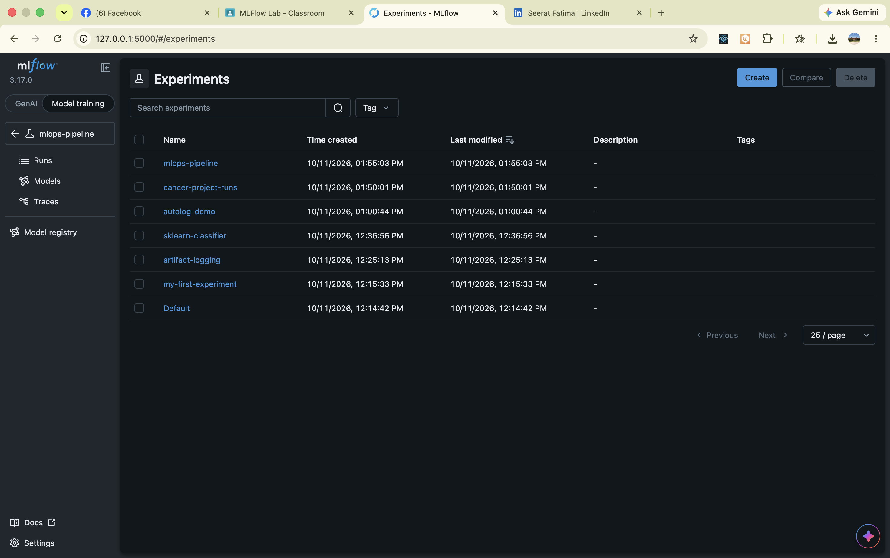
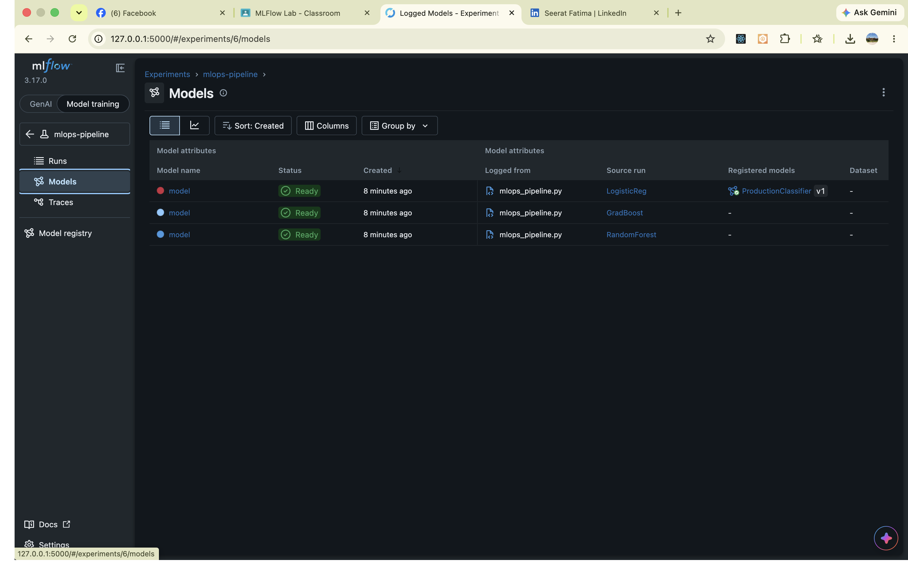
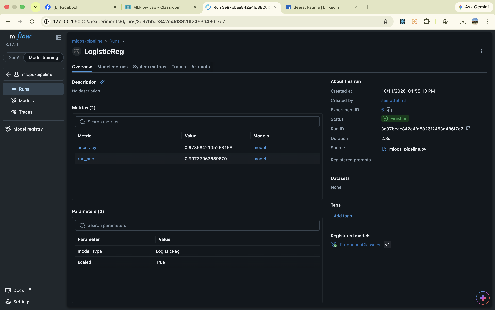
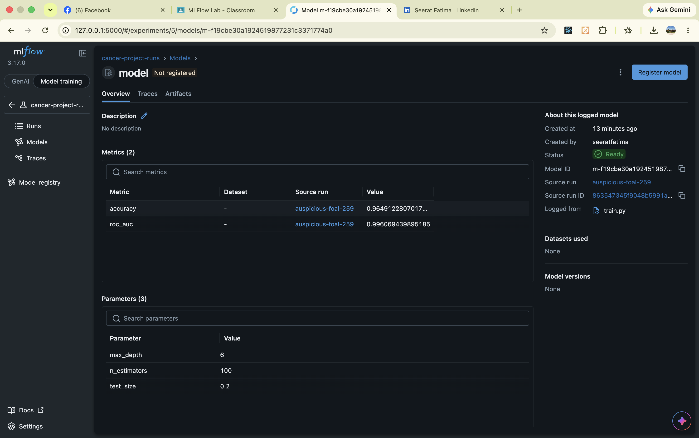
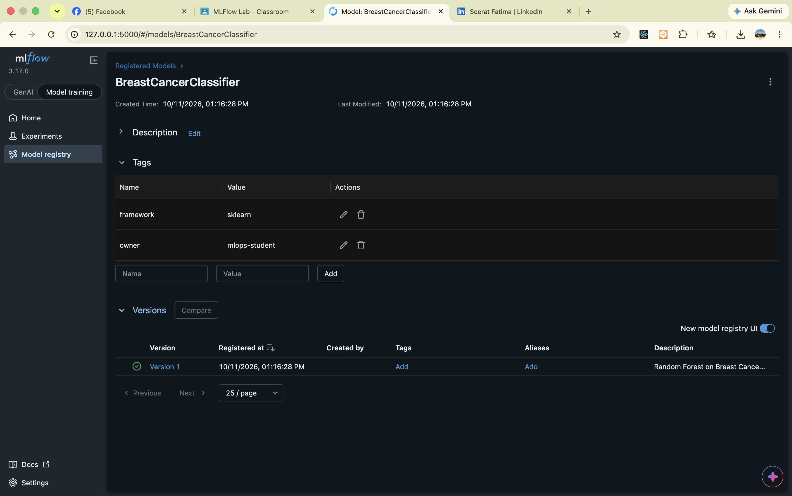

# MLflow MLOps Hands-on Lab 🚀

A comprehensive, production-grade hands-on project exploring MLflow for the complete Machine Learning lifecycle.

## 📌 Features & Architecture
- **Level 1 — Basics:** Experiment setup, SQLite backend store, parameters, metrics, tags, and file/plot artifacts.
- **Level 2 — Experiment Tracking:** Scikit-Learn Random Forest tracking, Parallel Coordinates comparison, zero-code tracking with `mlflow.autolog()`, and programmatic queries with `MlflowClient`.
- **Level 3 — Model Registry & Serving:** Enterprise Model Registry, semantic versioning, lifecycle stage transitions (`Staging` ➔ `Production`), and universal inference with `mlflow.pyfunc`.
- **Level 4 — Advanced Pipelines:** Standardized reproducibility with `MLproject` entry points, and an end-to-end automated Model Tournament with CI/CD quality promotion gates.

## 📊 Visualizations & UI Dashboard

### 1. Experiments Dashboard
Overview of all tracked experiments across the entire MLOps lifecycle:


### 2. Automated Model Tournament & Promotion
The candidate models evaluated in the pipeline, with the winning model promoted to Production:


### 3. Detailed Run Metrics & Evaluation
Deep-dive into individual run metrics (`accuracy`, `roc_auc`) and training hyperparameters:


### 4. Model Registry & Parameters
Standardized model schema, hyperparameters, and artifact metadata:


### 5. Centralized Model Registry & Governance
Production model catalog with version control, descriptions, and ownership tags:



## 🛠️ How to Run
```bash
# 1. Setup environment
python3 -m venv mlflow_env
source mlflow_env/bin/activate
pip install -r requirements.txt

# 2. Launch MLflow Tracking UI
mlflow ui --backend-store-uri sqlite:///mlflow.db

# 3. Run the automated tournament pipeline
python mlops_pipeline.py
```